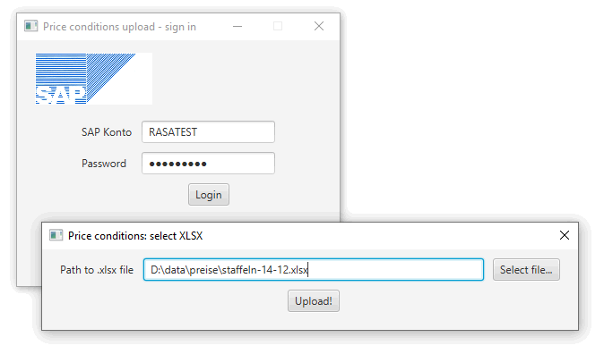

# price_cond

JavaFX-приложение для загрузки файла с ценами (`.xlsx`) в SAP (OData сервис `yrecord`).



## Стек

- Java 15
- JavaFX 15.0.1 (`javafx-controls`, `javafx-fxml`)
- Maven
- Apache HttpClient 4.5, Apache Olingo OData 4.7.1
- Spring Context 5.3
- toml4j 0.7.2 (чтение конфигурации)

## Конфигурация

Файл `src/main/resources/config.toml`, секция `[sap]`
`SapConfig.load()` сначала пытается прочитать `config.toml` из рабочей папки, иначе — из classpath.

## Сборка и запуск

```bash
mvn clean javafx:run
```
